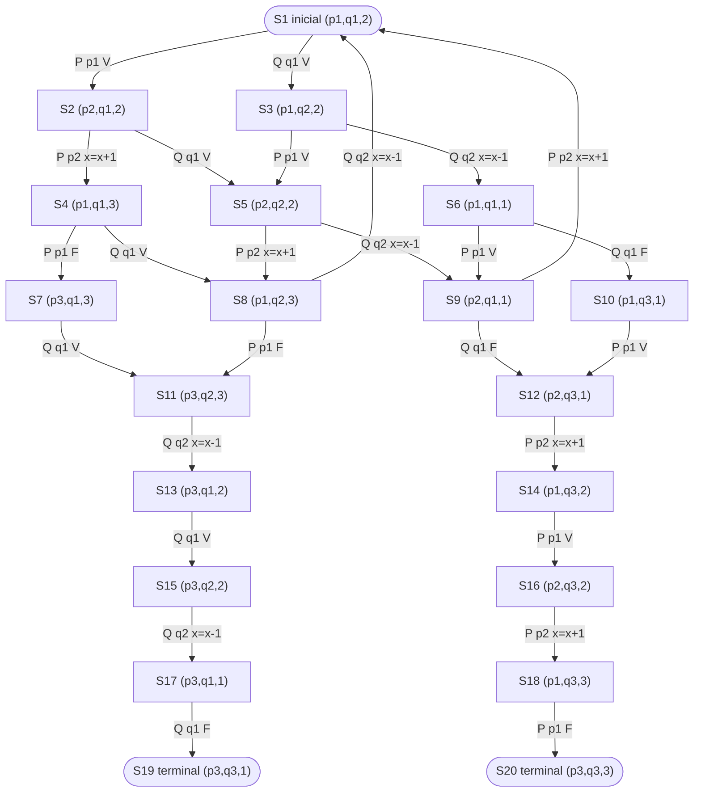

# **EXAMEN PARCIAL DE PROGRAMACIÓN CONCURRENTE Y DISTRIBUIDA**

HORA FIN: 21:30  
**PREGUNTAS HACERLO POR EL CHAT**

## **NOMBRES Y APELLIDOS: Diego Eduardo Ballon Villar**

## **Indicaciones**

* Resuelva las cuatro preguntas de manera individual. Se evalúa la implementación, el razonamiento sobre los posibles entrelazamientos y la evidencia de las pruebas. Utilice Go y Promela/SPIN según corresponda.  
* Entregue los archivos fuente y un informe con explicaciones y capturas de terminal en la actividad del Aula Virtual. Nombre los archivos preguntaN-parte-codigo. No se acepta únicamente una captura del código. En la pregunta 3 adjunte también la matriz de ejecución en una hoja de cálculo.  
* En Go, utilice sync.WaitGroup para esperar la finalización. time.Sleep solo puede simular trabajo; no sirve para garantizar que las goroutines hayan terminado. Pruebe las soluciones corregidas con go run \-race. El trabajo es individual, sin plagio ni uso de IA durante la evaluación.

## Pregunta 1 Créditos de impresión

Un laboratorio dispone de 300 créditos compartidos. Se lanzan 800 goroutines; cada una solicita imprimir un documento que cuesta 2 créditos. Una solicitud se acepta solo si hay saldo suficiente. Cada goroutine realiza un único intento y luego termina.

* Implemente una versión deliberadamente incorrecta que consulte y actualice el saldo sin protección. Describa un entrelazamiento que pueda causar una actualización perdida o una aceptación indebida. Ejecute el detector de carreras y explique su reporte. (0,75 puntos)  
* Corrija el programa con un mutex que proteja la comprobación del saldo y su descuento como una sola sección crítica. Registre también las solicitudes aceptadas y rechazadas sin introducir carreras. (0,75 puntos)  
* Muestre evidencias y justifique que la versión correcta termina con saldo 0, 150 solicitudes aceptadas y 650 rechazadas. Explique por qué una salida aparentemente correcta no demuestra que la primera versión esté libre de carreras. (0,50 puntos)

## Pregunta 2 Procesamiento de lotes de imágenes

Un servicio procesa 50 lotes de imágenes, identificados del 0 al 49\. Cada lote contiene 100, 200 o 300 imágenes, elegidas aleatoriamente. Simule el procesamiento completo de cada lote en una goroutine mediante time.Sleep: 300, 400 o 500 milisegundos, respectivamente. No debe crear archivos ni procesar imágenes reales.

Genere los tamaños en main antes de lanzar las goroutines, usando un generador local con semilla fija 2026\. Conserve esta lista sin modificarla durante el procesamiento. Calcule a partir de ella el total esperado para comprobar el resultado concurrente.

## **Recursos compartidos**

Acumulador: número total de imágenes procesadas. Cada goroutine añade el tamaño de su lote una sola vez al finalizar el trabajo simulado.

Auditoría: estructura con los campos registrado, idLote y cantidad. Guarde únicamente el primer registro. Para este examen, el ganador es la primera goroutine que adquiere el mutex de auditoría después de terminar su trabajo simulado, no necesariamente la que registra el menor tiempo de reloj.

## **Actividades y puntaje**

* Implemente las 50 goroutines y use sync.WaitGroup correctamente. El reporte final debe imprimirse únicamente después de que todas hayan terminado y registrado sus resultados. (1 punto)  
* Proteja el acumulador y la auditoría con dos mutex distintos. La consulta de registrado y la escritura completa del primer registro deben formar una única sección crítica. Ningún bloqueo debe abarcar el time.Sleep. (2 puntos)  
* Muestre el total esperado, el total calculado y el registro ganador. Compruebe que la cantidad registrada coincide con el lote indicado y que el registro no se sobrescribe. Adjunte una ejecución con el detector de carreras. (1 punto)  
* Explique qué puede ocurrir si se retira solo el mutex de auditoría. Distinga una carrera de datos de la variación válida del ganador entre ejecuciones. Explique además por qué, con ambos recursos protegidos y el reporte posterior a Wait, no se necesita adquirir ambos mutex al mismo tiempo para imprimir un reporte completo. (1 punto)

## **Condiciones de la solución**

Cada recurso debe quedar correctamente actualizado aunque el orden de finalización cambie. No se exige que un lector concurrente observe ambos recursos como una transacción: durante el procesamiento no habrá lectores externos. No utilice un mutex global que sustituya a los dos solicitados.

# **Pregunta 3 Estados y ejecuciones en Promela**

Dos procesos comparten una variable entera x, inicialmente igual a 2\. Sus variables de control comienzan en p1 y q1. Considere el siguiente pseudocódigo:

Proceso P                 Proceso Q  
p1: while x \< 3           q1: while x \> 1  
p2:     x \= x \+ 1          q2:     x \= x \- 1  
p3: fin                      q3: fin

## **Semántica obligatoria**

Evaluar la condición es un paso atómico. Si es verdadera, el proceso pasa a su asignación; si es falsa, termina. Cada asignación es otro paso atómico y, al completarse, el control vuelve a la condición. La condición y la asignación NO constituyen juntas una operación atómica. Un proceso en fin no ejecuta más pasos.

Represente cada estado como (pcP, pcQ, x), donde pcP pertenece a {p1, p2, p3} y pcQ a {q1, q2, q3}. El estado inicial es (p1, q1, 2). No imponga alternancia ni prioridades entre los procesos.

## **Actividades y puntaje**

* Construya el grafo completo de estados alcanzables. Numere los estados, indique la instrucción ejecutada en cada arista y señale el estado inicial y todos los estados terminales. Puede dibujar el grafo e incluir una tabla de estados y transiciones para facilitar su lectura. (3 puntos)  
* Construya una matriz de ejecución con las columnas paso, proceso, instrucción, estado anterior y estado posterior. Muestre un prefijo alcanzable y un ciclo que permitan que ambos procesos ejecuten sus cuerpos indefinidamente. Marque la repetición del estado completo y explique por qué el ciclo puede repetirse. No basta con repetir solo el valor de x. (2 puntos)  
* Modele ambos procesos en Promela. Preserve la separación entre la prueba y la actualización y modele explícitamente la salida cuando la condición sea falsa. Use spin \-i para reproducir el prefijo y al menos dos vueltas del ciclo encontrado. Ejecute también la búsqueda de estados de fin inválidos con el verificador de SPIN. Adjunte comandos, resultados y capturas. (2 puntos)

## **Análisis solicitado en el inciso c**

Explique si hay interbloqueo y distinga ese concepto de la terminación normal de ambos procesos y de una ejecución infinita con pasos habilitados. Indique si la ausencia de estados de fin inválidos permite concluir que todas las ejecuciones terminan. No se requiere formular propiedades LTL.

En la traducción, no agrupe la condición y la asignación dentro de atomic o d\_step. Si Promela introduce pasos auxiliares de control, indique cómo se corresponden con los estados del pseudocódigo.

# **Pregunta 4 Barrera reutilizable por rondas**

Una aplicación analiza imágenes mediante N \= 4 trabajadores persistentes, representados por goroutines. Cada trabajador ejecuta R \= 3 rondas. En cada ronda realiza una fase 1 de análisis local y una fase 2 de combinación simulada. Basta con simular el trabajo y registrar los eventos; no se requiere procesar imágenes ni compartir resultados numéricos.

## **Reglas de coordinación**

Ningún trabajador puede iniciar la fase 2 de una ronda hasta que los cuatro hayan terminado la fase 1 de esa ronda. Además, ningún trabajador puede iniciar la fase 1 de la siguiente ronda hasta que los cuatro hayan terminado la fase 2 de la anterior.

Implemente una barrera reutilizable y utilice la misma instancia al finalizar cada fase. El último en llegar debe habilitar el avance del grupo. Esto no exige que las cuatro goroutines reciban CPU exactamente al mismo instante. No cree trabajadores ni barreras nuevos en cada ronda.

Simule cada fase con una espera aleatoria de 50 a 150 ms. Use un generador local distinto por trabajador o genere las duraciones antes de iniciar las goroutines. Registre trabajador, ronda, fase y evento INICIO o FIN; imprima FIN antes de entrar en la barrera.

## **Mecanismos permitidos**

Construya la barrera con sync.Mutex y semáforos propios con métodos Wait y Signal. Use sync.WaitGroup únicamente para que main espere la finalización de los trabajadores. No use canales ni esperas activas. Puede emplear sync.Cond dentro del semáforo para suspender a quien no encuentre permisos.

type Semaforo struct {  
    mu   sync.Mutex  
    val  int  
    cond \*sync.Cond  
}  
// NewSemaforo(n): inicia n permisos, con n \>= 0\.  
// Wait(): espera un permiso y lo consume.  
// Signal(): agrega un permiso y notifica a un esperador.

Inicialice cond asociado a mu. No copie un semáforo una vez inicializado; utilice punteros. Puede agregar a la barrera los contadores y semáforos que su diseño requiera.

## **Actividades y puntaje**

* Implemente el constructor, Wait y Signal del semáforo con accesos protegidos y espera bloqueante correcta. (1 punto)  
* Implemente la barrera reutilizable y explique la función del contador y de cada molinete o puerta. Justifique cómo evita que los permisos de una ronda se consuman indebidamente en otra. (3 puntos)  
* Complete main y los trabajadores. Adjunte la traza de las tres rondas y una ejecución con go run \-race. Señale en la traza el cumplimiento de ambas reglas y explique por qué no hay carreras ni interbloqueo bajo el supuesto de que todos los trabajadores siguen ejecutándose. (2 puntos)

---

# RESPUESTAS

Archivos entregados: `pregunta1-a-incorrecta.go`, `pregunta1-b-correcta.go`, `pregunta2-codigo.go`, `pregunta3-modelo.pml`, `pregunta3-matriz.csv`, `pregunta4-codigo.go` y la carpeta `evidencias/` con las salidas de terminal.

## Pregunta 1 – Créditos de impresión

### a) Versión incorrecta (`pregunta1-a-incorrecta.go`)

Cada goroutine hace `if saldo >= 2 { saldo -= 2; aceptadas++ } else { rechazadas++ }` sin ninguna protección (con `runtime.Gosched()` entre la consulta y la actualización para hacer más probable el entrelazamiento).

**Entrelazamientos posibles** (saldo = 2, goroutines A y B):

| Paso | Goroutine | Acción | saldo |
|---|---|---|---|
| 1 | A | lee saldo (2 ≥ 2 → verdadero) | 2 |
| 2 | B | lee saldo (2 ≥ 2 → verdadero) | 2 |
| 3 | A | `saldo -= 2` | 0 |
| 4 | B | `saldo -= 2` | **-2** |

→ **aceptación indebida**: se aceptan dos documentos con crédito para uno solo (saldo negativo).

**Actualización perdida:** `saldo -= 2` y `aceptadas++` no son atómicos (cargar, operar, guardar). Si A y B cargan `aceptadas = 7`, ambas guardan 8 y se pierde un incremento.

**Evidencia** (`evidencias/p1a-sin-race.txt`, tres ejecuciones sin `-race`):

```
[INCORRECTA] saldo=-8  aceptadas=154 rechazadas=566 (esperado: 0/150/650)
[INCORRECTA] saldo=-4  aceptadas=152 rechazadas=608 (esperado: 0/150/650)
[INCORRECTA] saldo=-26 aceptadas=164 rechazadas=596 (esperado: 0/150/650)
```

Saldo negativo (aceptaciones indebidas) y `aceptadas + rechazadas < 800` (566 + 154 = 720, se perdieron 80 incrementos de `rechazadas`).

**Detector de carreras** (`go run -race pregunta1-a-incorrecta.go`, `evidencias/p1a-race.txt`, 7 avisos `DATA RACE`):

```
WARNING: DATA RACE
Write at 0x0000005dc728 by goroutine 11:
  main.solicitar()  pregunta1-a-incorrecta.go:27   (saldo -= costo)
Previous read at 0x0000005dc728 by goroutine 8:
  main.solicitar()  pregunta1-a-incorrecta.go:27
```

Interpretación: dos goroutines accedieron a la misma dirección (`saldo`), al menos una escribiendo, sin relación *happens-before* entre ellas (sin mutex, canal ni WaitGroup que las ordene). Otros avisos equivalentes aparecen para `aceptadas`, `rechazadas` y la lectura de `saldo` en la comprobación.

### b) Versión correcta (`pregunta1-b-correcta.go`)

```go
mu.Lock()
if saldo >= costo { saldo -= costo; aceptadas++ } else { rechazadas++ }
mu.Unlock()
```

La comprobación, el descuento y los contadores forman **una sola sección crítica**; así nadie puede intercalarse entre «consultar» y «descontar». Los contadores quedan protegidos por el mismo mutex, sin carreras. `main` imprime después de `wg.Wait()`, cuando ya no hay goroutines concurrentes.

### c) Evidencias y justificación

`go run -race pregunta1-b-correcta.go` (3 ejecuciones, sin avisos de carrera):

```
[CORRECTA] saldo=0 aceptadas=150 rechazadas=650 total=800
OK: saldo 0, 150 aceptadas, 650 rechazadas
```

**Por qué es necesariamente ese resultado:** el mutex serializa las 800 solicitudes. Mientras `saldo >= 2` cada solicitud descuenta exactamente 2. 300 / 2 = 150 solicitudes caben, cada una deja saldo par; tras la 150.ª el saldo es 0 y las 650 restantes encuentran `0 < 2` y son rechazadas. Como cada goroutine hace un único intento, 150 + 650 = 800.

**Salida correcta ≠ ausencia de carreras:** una carrera de datos es una propiedad de *todos* los entrelazamientos posibles, no de una ejecución. Con pocas goroutines o un planificador favorable, la versión incorrecta puede dar por casualidad 0/150/650 (las goroutines se ejecutan casi en serie) y aun así existir un entrelazamiento que la rompa. Probar no demuestra ausencia; por eso se usa el detector (`-race`) y el razonamiento sobre secciones críticas.

## Pregunta 2 – Lotes de imágenes (`pregunta2-codigo.go`)

Diseño:
- Los 50 tamaños se generan en `main` con `rand.New(rand.NewSource(2026))` antes de lanzar goroutines y no se modifican; de ahí se calcula `esperado`.
- `procesar(id, tam)`: `time.Sleep` (300/400/500 ms según 100/200/300) **sin ningún mutex tomado**; luego `muAcum` protege `acumulador += tam`, y `muAudit` (otro mutex) protege la consulta de `registrado` + escritura completa del primer registro.
- `wg.Wait()` antes de imprimir el reporte.

Evidencia con `go run -race` (3 ejecuciones, sin carreras; `evidencias/p2-race.txt`):

```
Total esperado : 9600
Total calculado: 9600
Registro ganador: idLote=39 cantidad=100 registrado=true
¿Total coincide? true | ¿cantidad == tamaño del lote 39? true
```

(Otras ejecuciones dieron `idLote=47`; el total siempre fue 9600, la cantidad siempre coincide con el lote y el registro no se sobrescribe.)

### Análisis

**Si se retira solo el mutex de auditoría:** `if !registrado { ...escribir 3 campos... }` deja de ser atómico. Dos goroutines pueden leer `registrado == false` a la vez y ambas escribir: (1) se sobrescribe el «primer» registro; (2) se puede mezclar `idLote` de una con `cantidad` de otra (registro inconsistente / *torn write*, p. ej. idLote=39, cantidad=300). Lo confirmé: `evidencias/p2-sin-mutex-auditoria-race.txt` muestra `DATA RACE` en la lectura/escritura de `auditoria`.

**Carrera vs. variación válida del ganador:** el ganador es «la primera que obtiene el mutex de auditoría», y eso depende del planificador (39 en dos ejecuciones, 47 en otra): es no determinismo *permitido*; cualquier ganador produce un registro coherente. Una carrera de datos es un acceso concurrente sin sincronización con al menos una escritura: el resultado puede ser inválido (registro mezclado, sobrescrito) y el detector la señala. Varios ganadores posibles ≠ carrera.

**Por qué no hace falta tomar ambos mutex para imprimir:** el reporte se imprime después de `wg.Wait()`; todas las goroutines ya terminaron y `Done()` *happens-before* el retorno de `Wait()`, por lo que `main` observa todas las escrituras. No hay escritores concurrentes, así que las lecturas no compiten y no se requiere ni siquiera una vista transaccional de ambos recursos (además, tomarlos juntos introduciría un riesgo de orden de bloqueo sin ningún beneficio).

## Pregunta 3 – Estados y ejecuciones en Promela

### a) Grafo de estados alcanzables

Semántica: evaluar la condición y asignar son pasos separados. Estados `(pcP, pcQ, x)`. Se generaron por búsqueda en anchura exhaustiva (`evidencias/p3-grafo-bfs.txt`): **20 estados alcanzables, estado inicial S1, 2 estados terminales (S19, S20)**. x solo toma valores 1, 2, 3.

| Estado | (pcP, pcQ, x) | Transiciones salientes |
|---|---|---|
| **S1 (inicial)** | (p1,q1,2) | P `p1: x<3 verdadero` → S2 ; Q `q1: x>1 verdadero` → S3 |
| S2 | (p2,q1,2) | P `p2: x=x+1` → S4 ; Q `q1: x>1 verdadero` → S5 |
| S3 | (p1,q2,2) | P `p1: x<3 verdadero` → S5 ; Q `q2: x=x-1` → S6 |
| S4 | (p1,q1,3) | P `p1: x<3 falso` → S7 ; Q `q1: x>1 verdadero` → S8 |
| S5 | (p2,q2,2) | P `p2: x=x+1` → S8 ; Q `q2: x=x-1` → S9 |
| S6 | (p1,q1,1) | P `p1: x<3 verdadero` → S9 ; Q `q1: x>1 falso` → S10 |
| S7 | (p3,q1,3) | Q `q1: x>1 verdadero` → S11 |
| S8 | (p1,q2,3) | P `p1: x<3 falso` → S11 ; Q `q2: x=x-1` → S1 |
| S9 | (p2,q1,1) | P `p2: x=x+1` → S1 ; Q `q1: x>1 falso` → S12 |
| S10 | (p1,q3,1) | P `p1: x<3 verdadero` → S12 |
| S11 | (p3,q2,3) | Q `q2: x=x-1` → S13 |
| S12 | (p2,q3,1) | P `p2: x=x+1` → S14 |
| S13 | (p3,q1,2) | Q `q1: x>1 verdadero` → S15 |
| S14 | (p1,q3,2) | P `p1: x<3 verdadero` → S16 |
| S15 | (p3,q2,2) | Q `q2: x=x-1` → S17 |
| S16 | (p2,q3,2) | P `p2: x=x+1` → S18 |
| S17 | (p3,q1,1) | Q `q1: x>1 falso` → S19 |
| S18 | (p1,q3,3) | P `p1: x<3 falso` → S20 |
| **S19 (terminal)** | (p3,q3,1) | — |
| **S20 (terminal)** | (p3,q3,3) | — |

Grafo (Mermaid; las aristas están etiquetadas con el proceso y la instrucción):



(V = condición verdadera, F = falsa.)

### b) Matriz de ejecución (`pregunta3-matriz.csv`)

Prefijo alcanzable (pasos 1-4) que llega a S1, y ciclo S1 → S2 → S4 → S8 → S1 recorrido dos veces:

| Paso | Proceso | Instrucción | Estado anterior | Estado posterior | Tramo |
|---|---|---|---|---|---|
| 1 | Q | q1: x>1 verdadero | (p1,q1,2) S1 | (p1,q2,2) S3 | prefijo |
| 2 | P | p1: x<3 verdadero | (p1,q2,2) S3 | (p2,q2,2) S5 | prefijo |
| 3 | Q | q2: x=x-1 | (p2,q2,2) S5 | (p2,q1,1) S9 | prefijo |
| 4 | P | p2: x=x+1 | (p2,q1,1) S9 | (p1,q1,2) S1 | prefijo |
| 5 | P | p1: x<3 verdadero | (p1,q1,2) S1 | (p2,q1,2) S2 | ciclo 1 |
| 6 | P | p2: x=x+1 | (p2,q1,2) S2 | (p1,q1,3) S4 | ciclo 1 |
| 7 | Q | q1: x>1 verdadero | (p1,q1,3) S4 | (p1,q2,3) S8 | ciclo 1 |
| 8 | Q | q2: x=x-1 | (p1,q2,3) S8 | **(p1,q1,2) S1** ← repetido | ciclo 1 |
| 9 | P | p1: x<3 verdadero | (p1,q1,2) S1 | (p2,q1,2) S2 | ciclo 2 |
| 10 | P | p2: x=x+1 | (p2,q1,2) S2 | (p1,q1,3) S4 | ciclo 2 |
| 11 | Q | q1: x>1 verdadero | (p1,q1,3) S4 | (p1,q2,3) S8 | ciclo 2 |
| 12 | Q | q2: x=x-1 | (p1,q2,3) S8 | **(p1,q1,2) S1** ← repetido | ciclo 2 |

**Por qué puede repetirse:** lo que se repite es el *estado completo* `(p1,q1,2)`, no solo `x`. En el ciclo ambos procesos ejecutan sus cuerpos (P: p1, p2; Q: q1, q2) y vuelven a sus condiciones. Como las transiciones solo dependen del estado actual, desde S1 vuelve a ser posible exactamente la misma secuencia de elecciones del planificador. No basta con ver `x = 2` repetido: `(p2,q2,2)` (S5) también tiene x=2 pero otro punto de control y por tanto otras transiciones. El ciclo es además *débilmente justo* (ambos procesos avanzan en él), así que no es un artefacto de dejar sin ejecutar a un proceso.

### c) Modelo Promela (`pregunta3-modelo.pml`)

```promela
byte x = 2;

active proctype P() {
p1: do
    :: x < 3 ->            /* p1: condición verdadera -> p2 */
p2:    x = x + 1           /* p2: asignación y vuelve a p1 */
    :: else -> break       /* p1: condición falsa -> p3 (fin) */
    od
}

active proctype Q() {
q1: do
    :: x > 1 ->
q2:    x = x - 1
    :: else -> break
    od
}
```

No hay `atomic` ni `d_step`: la guardia (`x < 3`) y la asignación son sentencias distintas, por tanto otro proceso puede intercalarse entre ellas. `p3`/`q3` («fin») es el final del cuerpo del `proctype` (estado final válido). Pasos auxiliares de Promela: el salto de vuelta del `do` y el `break` no son estados de tu pseudocódigo; el punto de control del `do` (único para ambas alternativas) corresponde a `p1`/`q1`, la sentencia etiquetada `p2`/`q2` es la asignación y el final del proceso es `p3`/`q3`.

Comandos a ejecutar:

```bash
spin -i pregunta3-modelo.pml          # simulación interactiva: seguir prefijo (pasos 1-4) y 2 vueltas del ciclo (pasos 5-12)
spin -a pregunta3-modelo.pml
gcc -o pan pan.c
./pan                                  # por defecto busca invalid end states
./pan -E                               # (opcional) sin chequear fin inválido
```

> **PENDIENTE (completar tú):** en el equipo donde preparé esto no pude instalar/compilar SPIN (sin `yacc`/`bison` ni permisos de `sudo`), así que **no tengo salida real de `spin`**. Pega aquí las capturas de `spin -i` (elige en cada paso el proceso indicado en la matriz) y de `./pan`. Lo que se espera, y que sí verifiqué con la búsqueda exhaustiva en `evidencias/p3-grafo-bfs.txt`: ningún estado alcanzable (salvo S19 y S20, finales válidos) carece de sucesores, es decir, `errors: 0` / sin «invalid end state».

### Análisis (inciso c)

- **Interbloqueo:** no hay. Interbloqueo = estado no terminal en el que ningún proceso tiene paso habilitado. Aquí toda condición (V o F) y toda asignación siempre está habilitada; los únicos estados sin sucesores son S19 y S20, donde ambos procesos están en `fin`.
- **Terminación normal:** S19 `(p3,q3,1)` y S20 `(p3,q3,3)`: ambos procesos llegaron a fin; es un estado final *válido*, no un interbloqueo.
- **Ejecución infinita con pasos habilitados:** el ciclo del inciso b: siempre hay pasos posibles, nadie está bloqueado, pero nunca se llega a fin. No es interbloqueo (hay progreso de pasos) sino **no terminación**.
- **¿La ausencia de estados de fin inválidos implica que todas las ejecuciones terminan?** No. Esa verificación solo asegura que no se llega a un estado sin sucesores que no sea final. No descarta ciclos infinitos con pasos habilitados (como el hallado, que además es justo). Probar terminación exige una propiedad de vivacidad (p. ej. «eventualmente ambos en fin»), que aquí es *falsa* por el ciclo.

## Pregunta 4 – Barrera reutilizable (`pregunta4-codigo.go`)

### Semáforo
`NewSemaforo(n)` crea `val = n` y `cond = sync.NewCond(&s.mu)`. `Wait()` toma `mu`, hace `for val == 0 { cond.Wait() }` (se suspende, sin espera activa; el `for` protege de despertares espurios o de otro consumidor) y consume (`val--`). `Signal()` toma `mu`, hace `val++` y `cond.Signal()`. Todos los accesos a `val` están bajo `mu`; se usan punteros (no se copia).

### Barrera (dos molinetes)

```go
type Barrera struct {
    n int; mu sync.Mutex; count int
    molinete1, molinete2 *Semaforo   // ambos inician en 0
}
func (b *Barrera) Esperar() {
    b.mu.Lock(); b.count++
    if b.count == b.n { for i := 0; i < b.n; i++ { b.molinete1.Signal() } }   // el último abre la puerta 1
    b.mu.Unlock(); b.molinete1.Wait()

    b.mu.Lock(); b.count--
    if b.count == 0 { for i := 0; i < b.n; i++ { b.molinete2.Signal() } }     // el último en cruzar abre la puerta 2
    b.mu.Unlock(); b.molinete2.Wait()
}
```

- **`count`**: cuántos hilos están dentro de la barrera. Sube en la llegada y baja en la salida; protegido por `mu`.
- **`molinete1` (puerta de llegada):** cerrado (0 permisos) hasta que llegan los N; el último en llegar deposita N permisos y todos cruzan.
- **`molinete2` (puerta de salida/rearme):** cerrado hasta que los N han cruzado la puerta 1 (cuando `count` vuelve a 0, el último deposita N permisos). Impide que un hilo rápido de la ronda siguiente «vuelva a entrar» y consuma un permiso de `molinete1` que pertenece a la ronda anterior.
- **Por qué no se mezclan permisos entre rondas:** al terminar `Esperar`, `count == 0` y ambos molinetes quedan con 0 permisos (se depositaron N y se consumieron N). Un hilo no puede llegar a la puerta 1 de la siguiente barrera (fase) antes de haber cruzado la puerta 2, y la puerta 2 solo se abre cuando *todos* ya consumieron su permiso de la puerta 1. Entonces ningún permiso de una fase puede ser tomado por un hilo de otra. Se usa **la misma instancia** para las 6 barreras (3 rondas × 2 fases).

### Main y trabajadores
`main` crea una sola barrera, un generador local `rand.New(rand.NewSource(100+id))` por trabajador (que precalcula sus duraciones de 50–150 ms) y lanza 4 goroutines persistentes, esperando con `WaitGroup`. Cada trabajador, por ronda y fase: registra `INICIO`, duerme, registra `FIN` y **luego** llama a `b.Esperar()`.

### Traza (extracto de `evidencias/p4-race.txt`, `go run -race`, 0 avisos de carrera)

```
[   0ms] trabajador=0 ronda=1 fase=1 INICIO      (4 INICIO de fase 1)
[  80ms] trabajador=1 ronda=1 fase=1 FIN
[  80ms] trabajador=0 ronda=1 fase=1 FIN         <- último FIN de la fase 1 (ronda 1)
[  80ms] trabajador=2 ronda=1 fase=2 INICIO      <- recién ahora arrancan fases 2
...
[ 227ms] trabajador=0 ronda=1 fase=2 FIN         <- último FIN de la fase 2
[ 227ms] trabajador=2 ronda=2 fase=1 INICIO      <- recién ahora arranca la ronda 2
```

Regla 1 (nadie inicia fase 2 antes de que los 4 terminen fase 1): los 4 `FIN` de ronda 1/fase 1 (56, 71, 80, 80 ms) preceden a todos los `INICIO` de fase 2 (≥ 80 ms). Regla 2: los 4 `FIN` de ronda 1/fase 2 (hasta 227 ms) preceden a todos los `INICIO` de ronda 2/fase 1 (227 ms). Se repite igual en las rondas 2 y 3 (495 ms y 601 ms). En la salida completa, entre la ronda 1/fase 1 y la 3/fase 2 hay 48 eventos (4 × 3 × 2 × 2).

(Los empates de milisegundo son por la resolución de 1 ms: la regla se cumple por construcción —cada `INICIO` está tras salir de la barrera—, no por el reloj.)

**Sin carreras:** `count` solo se toca bajo `b.mu`; `val` solo bajo `s.mu`; el log está bajo `logMu`; cada trabajador usa solo sus propias duraciones. `-race` no reportó nada.

**Sin interbloqueo (si todos los trabajadores siguen ejecutándose):** el N-ésimo en llegar siempre deposita N permisos en `molinete1`, así que nadie queda esperando para siempre; igualmente el último en cruzar la puerta 1 abre la puerta 2. Los permisos nunca se pierden ni sobran (se depositan exactamente N por puerta y por fase), y no se mantiene ningún lock mientras se espera en un semáforo (`mu` se libera antes del `Wait`), por lo que no hay espera circular.
